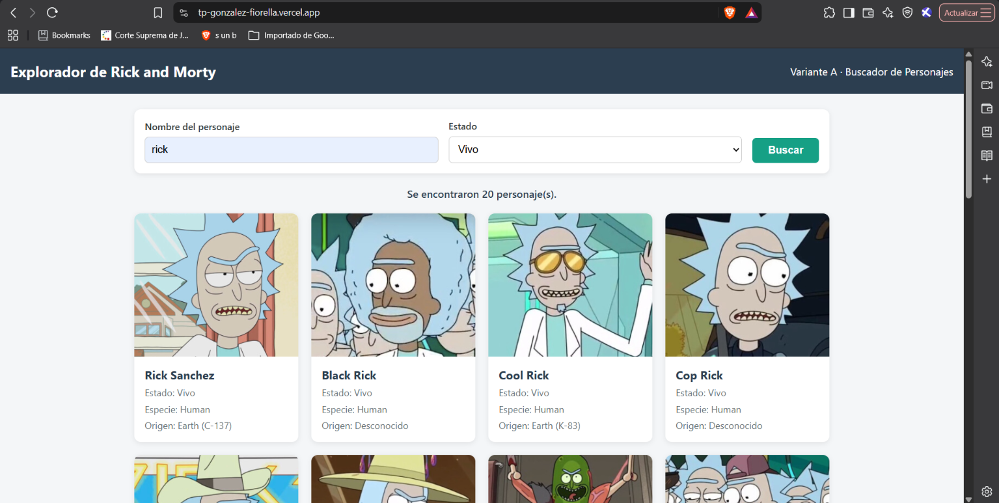

# Explorador de Personajes · Rick and Morty

Aplicación web de una sola pantalla que consume la API pública de Rick and Morty para buscar personajes por nombre y filtrarlos por estado, mostrando sus datos principales en tarjetas dinámicas.

**Autor:** Fiorella González · Fundamentos de Desarrollo Web · UCSA  
**Variante del TP:** A (Personajes)

## Sitios publicados
- GitHub Pages: https://fiofio7.github.io/tp-gonzalez-fiorella/
- Vercel: https://tp-gonzalez-fiorella.vercel.app

## Captura

## Funcionalidades
- Búsqueda de personajes por nombre y filtro combinado por estado (Vivo, Muerto, Desconocido).
- Visualización de resultados en tarjetas con imagen, nombre, estado, especie y lugar de origen.
- Manejo de estados de carga, búsquedas sin resultados (404) y errores de conexión.
- Persistencia de la última búsqueda realizada mediante `localStorage`.
- Diseño adaptable (responsive) con CSS Grid y Flexbox.

## Tecnologías
- HTML5, CSS3, JavaScript (ES6+), Fetch API, localStorage, API de Rick and Morty.

## Estructura del proyecto
text
tp-gonzalez-fiorella/
├── index.html       # Estructura semántica y formulario de búsqueda
├── README.md        # Documentación técnica del proyecto
├── .gitignore       # Archivos excluidos del control de versiones
├── css/
│   └── estilos.css  # Variables CSS, Flexbox, Grid y diseño responsive
├── js/
│   └── app.js       # Consumo de API, renderizado de tarjetas y localStorage
└── img/
    └── captura.png  # Captura de pantalla de la aplicación funcionando